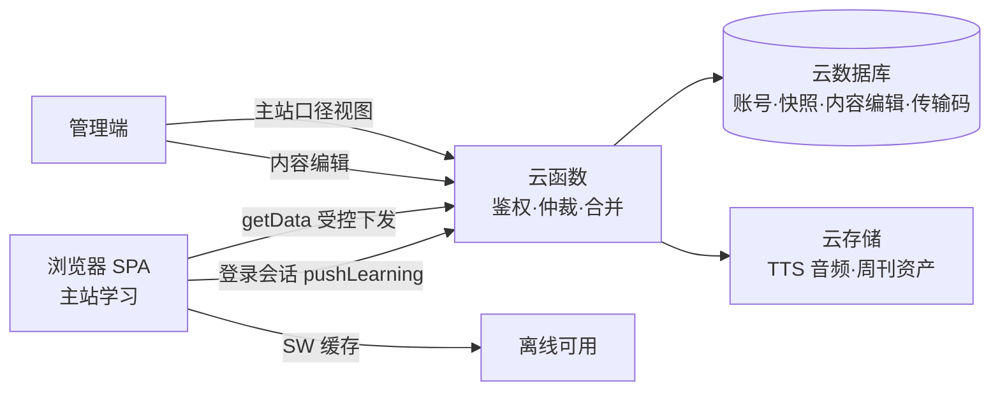

<div align="center">

# Ñ · A1–B2 西语备考工作台

**DELE & SIELE 全流程备考平台 · 纯静态单页应用 · 零构建零依赖**

[](CHANGELOG.md)
[](https://pages.github.com/)
[](#-技术架构)
[](#-技术架构)
[](#-数据规模)
[](LICENSE)

**线上地址**：<https://celina0503qq-lab.github.io/siele-workbench/>

</div>

---

## 📖 项目简介

一个把 DELE（A1–B2）与 SIELE 备考全流程装进浏览器的单页应用——词汇记忆、语法、题库测验、口语跟读评分、写作助手、外刊周刊、错题管理与学习计划，配合云函数后端实现**账号体系、跨设备云同步与管理端内容编辑**。

无框架、无构建步骤、无需安装——打开浏览器即用，离线也能继续学习。

## 📦 数据规模

| 维度 | 规模 | 说明 |
|---|---|---|
| 词汇库 | **4,815 词** | A1–B2 分级 · 西语子类目 · 拉美口音 es-MX 预生成发音 |
| 题库 | **6,000 题** | A1/A2/B1/B2 各 1,500 · 语法/词汇双题型 |
| 口语题库 | **316 题** | SIELE Tarea 1–5 官方流程对齐 · 逐问音频点播 |
| 语法 | **111 条** | 语法点详解 + 专项测验 |
| 外刊 | **每周更新** | RSS 聚合 · 精读题 · 词汇卡 · 逐段跟读音频（自动化流水线出刊）|
| DELE 专项 | A1–B2 全级 | 阅读 / 听力 / 写作 / 口语 / 全真模拟 |

## 🧩 功能模块

### 📚 学习
| 模块 | 深度特性 |
|---|---|
| 🏠 仪表盘 | 今日待办 · 签到 · 能力雷达 · 考试倒计时 · 快捷操作 |
| 🃏 单词卡片 | 翻牌 / 中西对应双模式 · 分级断点续背 · 记忆花园 · 每 10 词默写测试 |
| 📚 词汇库 / 📐 语法库 | 全库检索 · 语法点详解 · 例句与发音 |
| 🎯 SIELE 专项 | 口语五 Tarea **官方流程对齐**：严格模式 · 模考自动严谨 · 三问纯听 · 双话题二选一 · 每问计时 15/30s |
| ✏️ 题库测验 | 顺序 / 随机 / 搜索跳题 · 背题模式 · 逐题选项快照 |
| ✍️ 写作助手 | SIELE 写作 T1/T2 逐题范文 · 计时 · 自评维度 |
| 🗣 口语跟读 | Web Speech API 五维度评分 · 逐段音频 |
| 📅 学习计划 | 每日任务 · 周计划 · 打卡与番茄钟 |
| 🚨 错题集 | 六类错题池自动归集（词汇/变位/默写/题库/口语/跟读）|

### ☁️ 数据
| 能力 | 说明 |
|---|---|
| 跨设备云同步 | 学习快照按账号隔离 · **增量合并**（ts-LWW 仲裁）· 断网本地优先自动补推 |
| 设备迁移传输码 | 一次性 24h 传输码，账号+全部学习数据整体搬家（含数据摘要自证）|
| 错题救赎 | 跨设备同步 · 出池不拉回 · 救赎记录可恢复 |
| 后台数据看板 | 与主站**完全同口径**的可视化（各等级进度 · 掌握度分布 · 题库分布）|

### 🛠 平台
| 能力 | 说明 |
|---|---|
| 管理端 | 用户管理 · 功能授权开关 · 词库/题库内容编辑（云端下发全站生效）· 主站口径视图 |
| 离线可用 | Service Worker 全量预缓存 · 版本号驱动全设备增量更新 |
| 隐私优先 | 学习数据仅存自有后端，**不经过任何第三方服务** |

## 🏗 技术架构

| 层 | 说明 |
|---|---|
| 前端 | 纯静态单页应用（HTML + 模块化外链 JS），**无框架、无构建步骤** |
| 后端 | CloudBase 云函数：账号鉴权 · 学习快照同步（revision 仲裁 + 冲突合并）· 受控数据集下发（每日限频）· 密码修改记录 |
| 数据 | 云数据库（账号档案 · 学习快照 · 内容编辑 · 传输码）+ 云存储（TTS 音频资产） |
| 管理端 | 独立管理页面：用户与授权管理 · 内容编辑 · 数据看板（主站口径可视化） |
| 离线 | Service Worker：全量预缓存 + 版本号驱动增量更新 |
| 资产 | TTS 预生成音频（双口音）· 外刊周刊自动化流水线 |

### 数据流



### 同步机制

- **快照增量**：种子词/题在代码内置，云端只同步「有状态」的进度（`seedW` 精简对 · 用户自建词题）——快照体积恒定可控
- **合并仲裁**：`revision` 版本号 + `ts-LWW`（后写者赢）+ 冲突时自动双向合并，多数数据「只增不减」
- **断网兜底**：同步失败本地数据保留，恢复后自动补推（界面实时提示同步健康状态）

## 🚀 本地预览

无需构建——任意静态服务器指向仓库根目录即可：

```bash
npx serve .        # 或 python -m http.server 8080
```

> 完整功能（云同步 / 管理端 / 受控数据集）需配置自有 CloudBase 环境与账号体系。

## 📖 版本历史

全部变更见 **[CHANGELOG](CHANGELOG.md)**——自 v92.1 起逐版记录（196+ 版，每版一行不遗漏）。

## 📄 License

本项目以 [MIT License](LICENSE) 开源。

---

<div align="center">

**¡Mucha suerte en tu examen!**

*Hecho con cariño para los estudiantes de español* 🇪🇸

</div>
